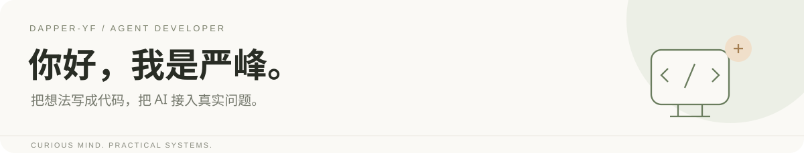
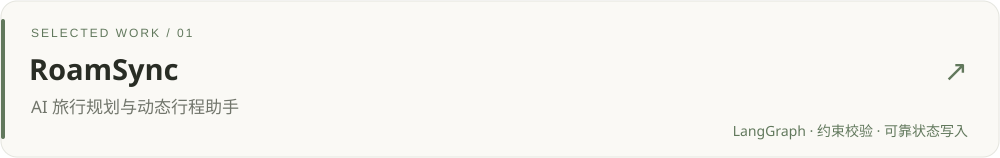

  <a href="mailto:1851075544@qq.com">邮箱</a> ·
  <a href="#精选项目">精选项目</a> ·
  <a href="#技术与实践">技术与实践</a>

我叫 **严峰**，江西师范大学软件工程本科，**2028 届**。正在寻找 **Agent / 大模型应用开发实习**。

我关注 AI 应用从回答问题到完成任务的过程：如何检索可靠证据、管理多轮状态，以及让模型输出经过规则校验和用户确认后落到业务系统中。

目前持续开发 RoamSync，也有企业项目中的 RAG、智能客服与系统部署实践。

## 精选项目

**个人项目 · 开发中。** 围绕咨询、候选行程、动态调整和用户确认，实践 LangGraph 编排、约束校验、候选与正式行程隔离。

**企业项目实习 · 独立开发。** 完成资料导入、带来源的知识答疑、练习生成与审核流程，供 4 人内部试用。公开版提供整理后的源码。

**商业团队项目 · Agent 核心开发 / 阶段负责人。** 参与多字段需求提取、多轮上下文、知识检索和部署协作；仓库整体能力由团队共同完成。因商业保密，源码不公开，面试时可在授权范围内介绍设计与个人贡献。

## 技术与实践

| 方向 | 项目中使用与实践 |
| --- | --- |
| 后端 | Python · FastAPI · Java · Spring Boot |
| Agent | LangGraph · LangChain4j · 工具调用 · 结构化输出 · 多轮状态 |
| 检索与存储 | BM25 / 向量混合检索 · RRF · PostgreSQL · MySQL · Qdrant |
| 工程 | Docker · Git / Codeup · 接口联调 · 测试与部署 |

我正在继续完善 Agent 评估、失败恢复与实际用户体验。实现范围、运行条件和已知限制写在各项目 README 中。

---

**联系我**：[1851075544@qq.com](mailto:1851075544@qq.com) · Agent / 大模型应用开发实习

浅色留白、精简导航与项目优先的展示结构，参考 DIYgod 的个人名片式表达；图形与文案为本主页独立制作。
